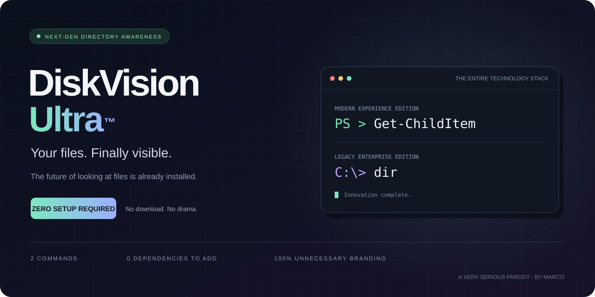
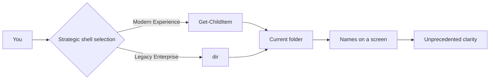

<div align="center">



### The future of looking at files is already installed.

[](#compatibility)
[](#installation)
[](#frequently-anticipated-questions)
[](LICENSE)

**[Quick start](#quick-start)** · **[Architecture](#architecture)** · **[Editions](#choose-your-edition)** · **[Nederlands](docs/NEDERLANDS.md)**

*Enterprise vocabulary. Household functionality.*

</div>

---

## A new era of directory awareness

For too long, files have existed inside folders without a dedicated product launch.

**DiskVision Ultra™** brings unprecedented visibility to the contents of your current directory. Discover filenames. Observe folders. Experience the profound reassurance that your documents are, in fact, somewhere.

No installer. No account. No subscription. No executable in this repository.

> **This is a parody product page.** The entire “tool” consists of the two built-in commands below. They list the current folder; they do not analyse disk usage or scan your entire drive.

## Quick start

### Modern Experience Edition

Open PowerShell in the folder you want to inspect:

```powershell
Get-ChildItem
```

### Legacy Enterprise Edition

Open Command Prompt in the folder you want to inspect:

```cmd
dir
```

That is the complete product. You have finished onboarding.

## Why DiskVision Ultra?

| Capability | The breakthrough |
| :--- | :--- |
| **Directory intelligence** | Lists the contents of the current folder. |
| **Human-readable observability** | Filenames appear as text. On your screen. |
| **Local-first execution** | The commands run on your computer. Remote folders still require a network connection. |
| **Zero additional dependencies** | Uses the command shell you already have. |
| **Frictionless deployment** | There is nothing to deploy. |
| **Agent-free architecture** | No background service. No model. No suspiciously busy tray icon. |
| **Bring your own files** | You already did. |

## Architecture



<div align="center">

*Seven diagram nodes of value. Two commands of implementation.*

</div>

## Choose your edition

| | Modern Experience | Legacy Enterprise |
| :--- | :---: | :---: |
| Underlying technology | PowerShell | Command Prompt |
| Command | `Get-ChildItem` | `dir` |
| Lists files and folders | ✓ | ✓ |
| Output | PowerShell objects, displayed as a table | Text |
| Additional installation | None, when PowerShell is available | None, when CMD is available |
| Mandatory cloud account | No | No |
| Monthly fee | €0 | €0, but with more gravitas |
| Premium support | Read the command again | Read the shorter command again |

Both editions use their shell’s default behaviour. Formatting and the items shown can differ. Hidden/system items are not guaranteed to appear. Neither command above performs a recursive scan.

## Installation

<details>
<summary><strong>Expand the complete installation procedure</strong></summary>

You may close this section. Installation is complete.

</details>

## Performance

We removed the application to reduce application overhead.

No benchmarks were performed. Listing time depends on the directory, filesystem, permissions and storage connection. The charts were cancelled when someone asked what they would measure.

## Roadmap

- [x] Display filenames
- [x] Support folders containing files
- [x] Add a second command and call it an edition
- [x] Commission a banner larger than the implementation
- [ ] Evaluate whether scrolling counts as pagination
- [ ] Resist the urge to add a subscription
- [ ] Reach feature parity with the commands we already use

## Frequently anticipated questions

**Does it use AI?**  
No. The filenames were there the whole time.

**Can it tell me which folder is using all my disk space?**  
Not with these commands alone. This is a directory listing, not a disk-usage analyser.

**Where is the download button?**  
We achieved zero-download distribution by not distributing an application.

**Will this delete anything?**  
These two commands list items; they do not delete them. Access errors may occur for folders you cannot read.

**Why is the documentation longer than the software?**  
Enterprise readiness.

**Is the ™ serious?**  
It is part of the joke. No trademark registration is claimed.

## Compatibility

The instructions target Windows with PowerShell or Command Prompt available. `Get-ChildItem` is also a PowerShell command on other platforms; `dir` here specifically means the Windows CMD built-in.

## Contributing

See [CONTRIBUTING.md](CONTRIBUTING.md). Improvements to the joke are welcome. Adding an actual storage engine would be a significant architectural regression.

## Credits

Made by **[Marco](https://github.com/marcovanthoog)**, for people who appreciate a beautifully over-engineered explanation of a very small thing.

The actual functionality is provided by Microsoft’s built-in [Get-ChildItem](https://learn.microsoft.com/en-us/powershell/module/microsoft.powershell.management/get-childitem) and [dir](https://learn.microsoft.com/en-us/windows-server/administration/windows-commands/dir) commands. This project is not affiliated with Microsoft.

Original repository content is available under the [MIT License](LICENSE).

---

<div align="center">

**DISKVISION ULTRA™**  
*Your files. Finally visible.*

<sub>No files were innovated upon during the making of this repository.</sub>

</div>
